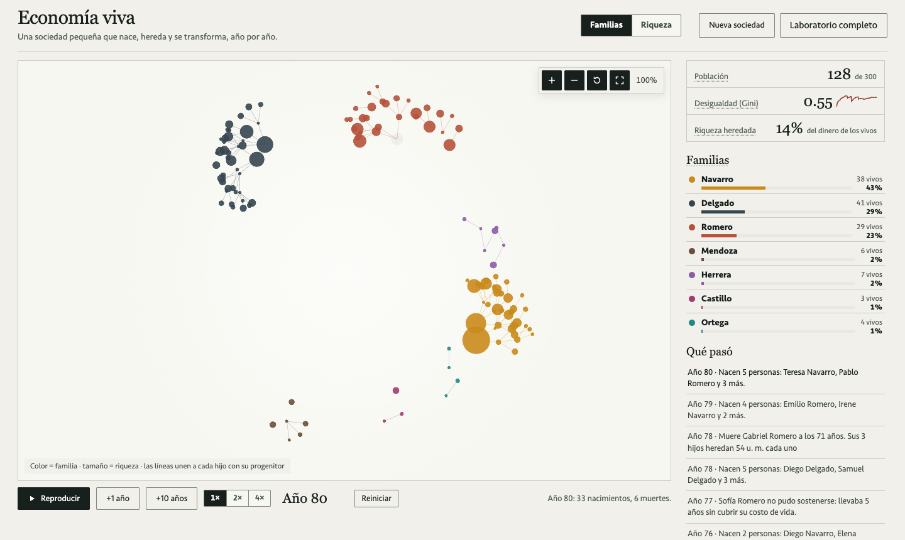
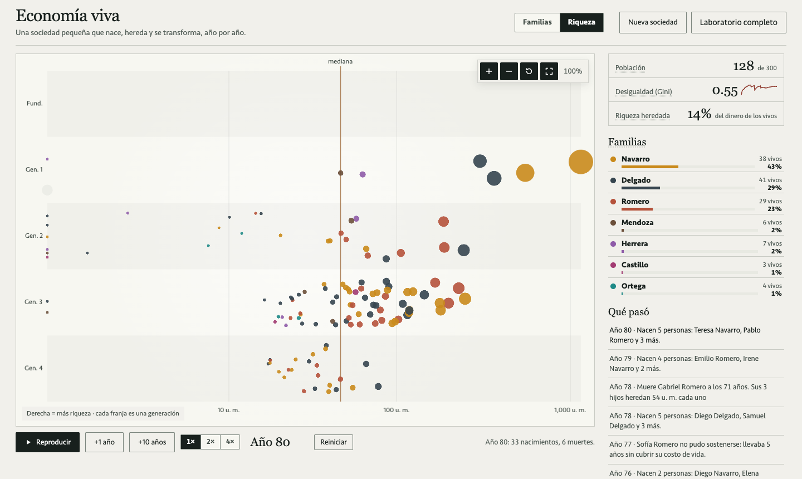
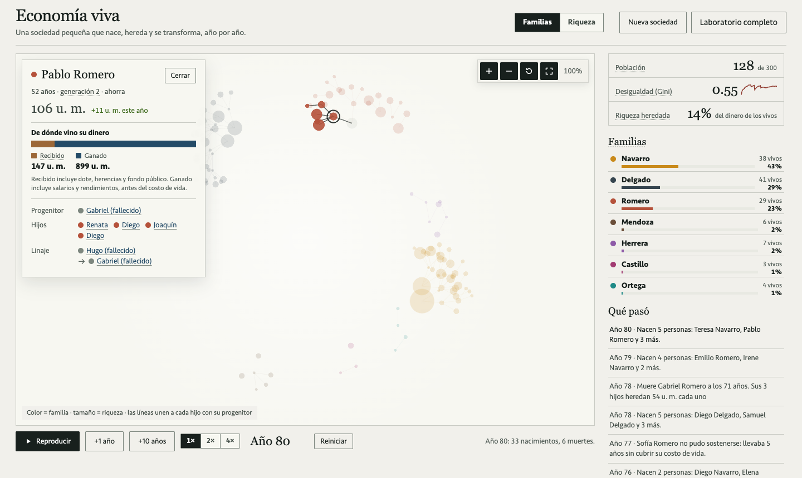
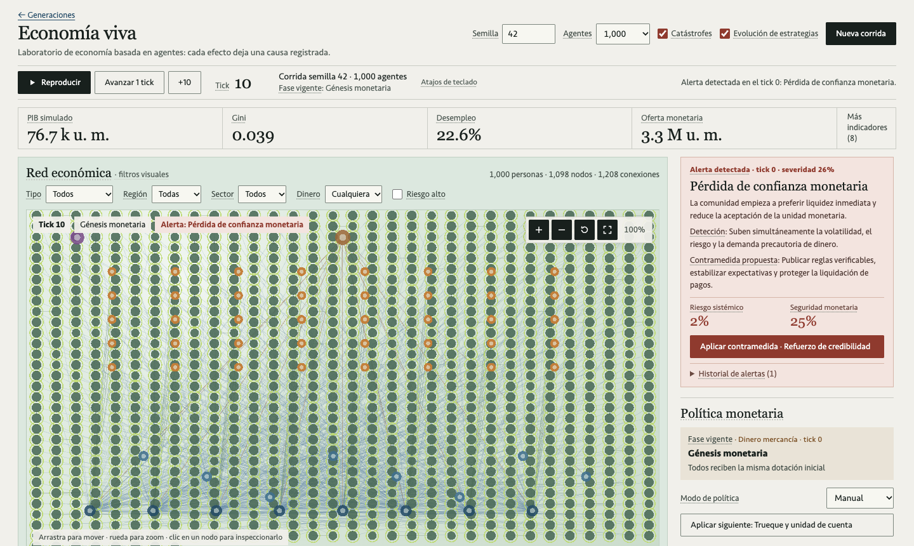

# Economía viva · GlobalEconomy

Laboratorio didáctico de economía basada en agentes. Una sociedad pequeña nace con el mismo dinero para todos y, año tras año, sus familias se reproducen, heredan, prosperan o se extinguen. Así se ve de dónde sale la desigualdad. Detrás hay un laboratorio completo con bancos, crédito, política monetaria, crisis y detección de fraude.

El motor está escrito en Rust y es determinista: con la misma configuración y la misma semilla, la corrida es idéntica. La interfaz usa React y PixiJS (WebGL) y está toda en español. Pensada para clases de economía en escritorio o proyector.



## Qué puedes hacer

**Generaciones** es la vista principal.

- **Fundar una sociedad.** Eliges cuántas familias fundadoras hay, la población máxima, el impuesto a la herencia, el rendimiento del capital y la semilla.
- **Verla evolucionar.** Cada hijo nace junto a su progenitor, los fallecidos se desvanecen y las herencias viajan como puntos dorados hacia los herederos.
- **Cambiar entre dos mapas.** *Familias* muestra los linajes en abanico. *Riqueza* coloca a cada persona por su dinero (eje x, en escala logarítmica) y su generación (eje y), con la mediana marcada.
- **Leer qué pasó en lenguaje sencillo.** Ejemplo: «Año 78 · Muere Gabriel Romero a los 71 años. Sus 3 hijos heredan 54 u. m. cada uno».
- **Inspeccionar a cualquier persona.** Su ficha separa el dinero **recibido** (dote, herencias, fondo público) del **ganado** (salario y rendimientos) y muestra su progenitor, sus hijos y su linaje hasta el fundador.

| Riqueza por generación | Ficha de una persona |
|---|---|
|  |  |

El **Laboratorio completo** (`#laboratorio`) simula hasta 100,000 agentes. Incluye empresas, bancos, gobierno, banco central y mercados regionales, 69 hitos de historia monetaria, shocks, alertas de riesgo sistémico con sus contramedidas, alertas AML y fiscales, replay de ticks y comparación de corridas.



## Arranque local

Necesitas Rust estable y Node 20 o superior.

```bash
cargo run --release          # API en http://localhost:8080
cd web && npm install && npm run dev   # UI en http://localhost:5173
```

Pruebas:

```bash
cargo test                   # motor, Generaciones y handlers de la API
cd web && npx tsc -b         # tipos de la UI
node scripts/api-smoke.mjs   # contrato HTTP, con el servidor corriendo
```

Para correr el smoke test aislado, usa otro puerto y otra carpeta de datos:

```bash
GLOBALECONOMY_PORT=8090 GLOBALECONOMY_DATA_DIR=/tmp/ge-smoke cargo run --release
GLOBALECONOMY_BASE_URL=http://127.0.0.1:8090 node scripts/api-smoke.mjs
```

## Reglas de Generaciones

Cada tick es un año, y cada paso se puede explicar en una frase.

1. **Envejecer.** Todos cumplen un año más.
2. **Ganar.**
   - Quien tiene entre 18 y 64 años cobra un salario según su habilidad.
   - El dinero acumulado rinde según la estrategia: quien *ahorra* obtiene el rendimiento completo, quien *consume* una cuarta parte, y quien *emprende* asume riesgo.
3. **Costo de vida.**
   - Cada adulto paga el suyo, y el progenitor paga el de sus hijos menores.
   - Nadie queda con dinero negativo. Quien no alcanza a cubrir su costo de vida acumula años de penuria.
4. **Nacimientos.**
   - Pueden tener un hijo quienes tienen entre 20 y 45 años, al menos 60 u. m. y menos de 4 hijos.
   - Cerca de la población máxima nacen menos.
   - Cada hijo recibe una **dote** del 25% del dinero de su progenitor. Hereda la estrategia, pero su habilidad tiende al promedio.
5. **Muertes.**
   - La probabilidad crece con la edad.
   - Quien pasa 5 años seguidos sin cubrir su costo de vida no puede sostenerse.
6. **Herencia.**
   - Primero se cobra el impuesto a la herencia y el resto se reparte por igual entre los hijos vivos.
   - Si no quedan hijos vivos, todo va al fondo público.
7. **Redistribución.** El fondo público se reparte por igual entre todas las personas vivas.

Contrastes que conviene probar en clase:

- **Impuesto a la herencia** de 0% contra 80%: con el impuesto alto, el Gini queda más bajo. Hay un test que lo comprueba en 10 semillas.
- **Rendimiento del capital** alto contra bajo: con un rendimiento alto, las fortunas heredadas crecen más rápido que los salarios.

Las corridas de Generaciones viven en memoria. Si el servidor se reinicia, la UI recrea la sociedad en el mismo año a partir de su semilla.

## API

El contrato completo está en [`schemas/openapi.yaml`](schemas/openapi.yaml).

**Generaciones**

| Método | Ruta | Uso |
|---|---|---|
| `POST` | `/api/generations` | Crea una sociedad. `{config, advance_to?}` la reproduce de forma determinista hasta el año indicado. |
| `POST` | `/api/generations/{id}/step` | Avanza de 1 a 50 años (`{count}`) y devuelve el snapshot y todos los eventos. |
| `POST` | `/api/generations/{id}/reset` | Vuelve al año 0 con la misma semilla. |
| `GET` | `/api/generations/{id}/snapshot` | Estado actual: personas vivas y fallecidas en los últimos 3 años. |
| `GET` | `/api/generations/{id}/person/{pid}` | Una persona con su progenitor, sus hijos y sus ancestros. |

**Laboratorio**

| Método | Ruta | Uso |
|---|---|---|
| `POST` / `GET` | `/api/runs` | Crea corridas o las lista. |
| `POST` | `/api/runs/compare` | Compara métricas de varias corridas en un tick común. |
| `POST` | `/api/runs/{id}/step` · `start` · `pause` · `reset` | Control de la corrida. |
| `POST` | `/api/runs/{id}/policy` · `policy/next` · `policy-mode` | Política monetaria manual o automática. |
| `POST` | `/api/runs/{id}/shock` · `risk/countermeasure` | Shocks sintéticos y contramedidas. |
| `POST` | `/api/runs/{id}/compliance/{alert_id}/resolve` | Marca una alerta AML o fiscal como revisada. |
| `GET` | `/api/runs/{id}/snapshot` · `history` · `metrics` · `replay/{tick}` | Estado, historial y replay exacto. Responde `410` si el tick ya salió de la ventana local. |
| `GET` | `/api/runs/{id}/metrics.parquet` | Serie de métricas en Parquet para DuckDB, Python o notebooks. |
| `GET` | `/api/runs/{id}/events` · `transactions` | Eventos y transacciones, con filtros por tick, tipo, entidad, región, riesgo y monto. |
| `GET` | `/api/runs/{id}/stream` | WebSocket con `snapshot`, `metric_update`, `transaction`, `alert` y `run_status`. |

## Arquitectura

```
src/lib.rs              motor del laboratorio (Simulation)
src/generations.rs      motor de Generaciones (GenSim), independiente del laboratorio
src/main.rs             servidor Axum, persistencia y rutas del laboratorio
src/generations_api.rs  rutas de Generaciones
src/bin/scale-benchmark.rs
web/src/                React + Zustand + PixiJS v8
schemas/openapi.yaml    contrato HTTP
wasm/                   adaptador WASM opcional para escenarios pequeños
```

- **Determinismo.** Cada tick usa un RNG `ChaCha8` sembrado con `semilla ^ tick`. El hash de configuración (SHA-256) identifica cada corrida.
- **Generaciones** guarda a las personas en un vector al que solo se agregan registros: los fallecidos no se borran, así que la genealogía siempre está completa. Las posiciones del mapa de familias se fijan al nacer, para que el mapa no salte entre años.
- **Persistencia del laboratorio.**
  - El estado de cada corrida se guarda en `data/runs/run-{id}.json` con escritura atómica.
  - Los snapshots se agregan a `run-{id}.snapshots.jsonl`, con un índice de offsets para que el replay no tenga que releer todo el log.
  - En memoria se conservan los últimos 240 snapshots.
  - `GLOBALECONOMY_DATA_DIR` cambia la carpeta.
- **Renderizado.** React maneja los controles y PixiJS dibuja la red en WebGL.
  - En el laboratorio, las conexiones se agrupan por tipo y la selección de nodos usa una rejilla espacial.
  - En Generaciones, cada persona es un sprite con transiciones interpoladas.
  - Con un tope de 2,000 personas a velocidad 4× se mantiene a 60 fps.

## Rendimiento

```bash
cargo run --release --bin scale-benchmark
```

Mide la inicialización y un tick con 1,000, 10,000 y 100,000 agentes, junto con el tamaño del snapshot. La meta es que un tick de 10,000 agentes tarde menos de 100 ms. En desarrollo, `POST /step` con 10,000 agentes tardó 33 ms (payload de unos 2.66 MB).

<details>
<summary>Detalle del modelo del laboratorio</summary>

- **Historia monetaria.** 69 hitos sintéticos: dinero mercancía, banca central, patrón oro, Bretton Woods, SDR, tipos flotantes, euro, metas de inflación, QE, tasas cero y negativas, criptoactivos, stablecoins, CBDC y política macroprudencial. En modo manual el usuario aplica cada hito; en modo automático se respeta la agenda de ticks. Es una traducción didáctica, no una reconstrucción cuantitativa.
- **Instituciones.** Empresas, bancos, gobierno, banco central y mercados regionales. Cada tick registra nóminas, impuestos, transferencias y compras como transacciones explicables. `RunConfig.institutions` ajusta cuántas empresas, bancos y sectores hay.
- **Crédito.** Hay préstamos cuando falta liquidez, con creación monetaria, amortizaciones y quiebras con liquidación registrada.
- **Catástrofes y shocks.** Son opcionales y reproducibles por semilla: crisis bancaria, burbuja inmobiliaria, deuda soberana, shock sanitario e inflación de oferta.
- **Riesgo sistémico.** Antes de cada política puede aparecer una alerta con su causa, la señal que la detectó, su severidad, una contramedida y las métricas de antes y después.
- **Integridad.** Reglas transparentes de AML y evasión fiscal: crédito desproporcionado, estructuración cerca de umbrales, ciclos de transferencias y ventas sin caja. Son señales sintéticas para practicar detección; no describen personas reales.
- **Estrategias.** `scenario_config.evolution` permite que los agentes cambien entre ahorrar, consumir y emprender, con mutación reproducible.
- **Métricas.** PIB, Gini, desempleo, oferta monetaria, quiebras, concentración bancaria, brecha regional y movilidad entre deciles.

</details>

## Licencia

MIT
